# Кав'ярня «Зерно» (`coffee_heneliuk`)

Лабораторна робота 3-5: верстка інтерфейсу за макетом та розробка багатоекранного застосунку на Flutter (високий рівень).

**Виконав:** Генелюк Н. О., гр. ІПЗ-42

## Реалізований функціонал

- Екран **«Меню»** з блоком привітання, фільтром категорій (`Wrap`, `ChoiceChip`), адаптивною сіткою товарів (`MediaQuery`: 2 стовпці в портретній орієнтації, 3 — в альбомній) та лічильником кошика (`Badge`).
- Екран **«Деталі товару»** з `Hero`-анімацією, вибором кількості та додаванням у кошик зі `SnackBar`.
- Екран **«Кошик»** зі списком `ListView.builder`, видаленням позицій свайпом (`Dismissible`) та підсумковою сумою (`RichText`).
- Екран **«Оформлення замовлення»** з валідацією форми (`Form`, `TextFormField`), перемикачем доставки (`SwitchListTile`) та анімованим підтвердженням (`AnimatedContainer`).
- Тема на базі `ColorScheme.fromSeed(seedColor: Color(0xFF6D4C41))`, пакет `material_ui`, власні зображення (`assets/images/`) та семантичні описи (`Semantics`, `tooltip`).

## Джерела зображень

Зображення товарів у каталозі `assets/images/` (`cappuccino.png`, `latte.png`, `americano.png`, `croissant.png`, `cheesecake.png`, `tea.png`) використані з відкритих джерел із вільною ліцензією.

## Скріншоти

1. **Результат `flutter doctor`** — перевірка налаштування середовища (у Flutter 3.50.1 окремий пункт Android Studio прибрано з виводу `flutter doctor`; встановлення Android Studio підтверджується шляхом JBR у `Android toolchain` та скріншотом № 2).

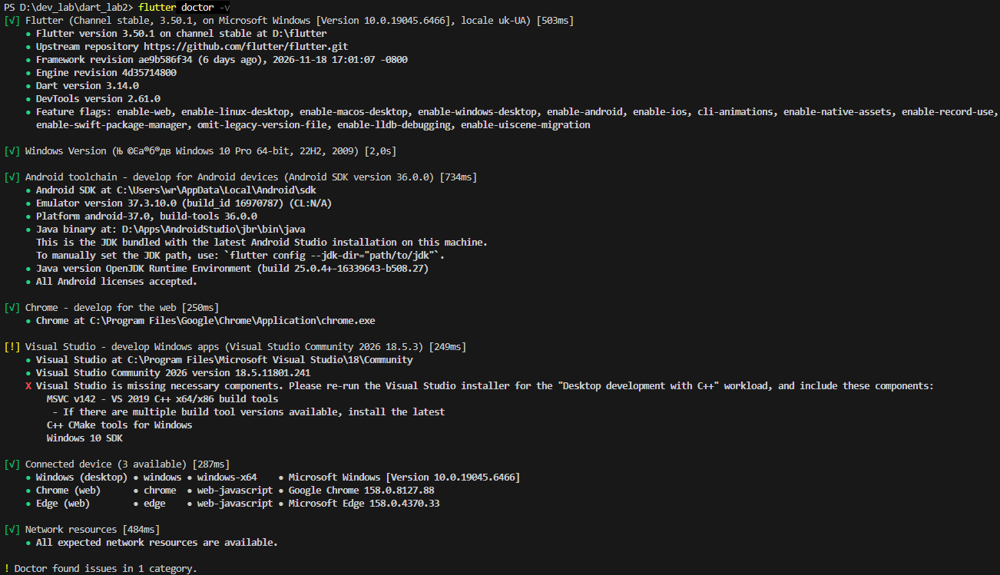

2. **Вікно Android Studio** — відкритий проєкт `coffee_heneliuk` із підключеним Android-пристроєм.

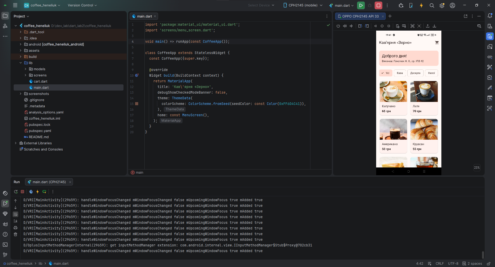

3. **Екран «Меню»** — головний екран із блоком привітання (`Виконав: Генелюк Н. О., гр. ІПЗ-42`) та сіткою товарів.

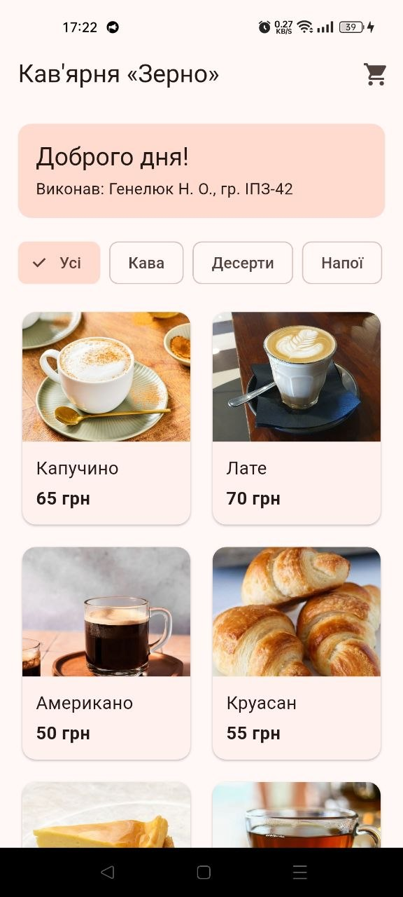

4. **Екран «Деталі товару»** — перегляд товару «Чізкейк» із зображенням, ціною, описом та вибором кількості.

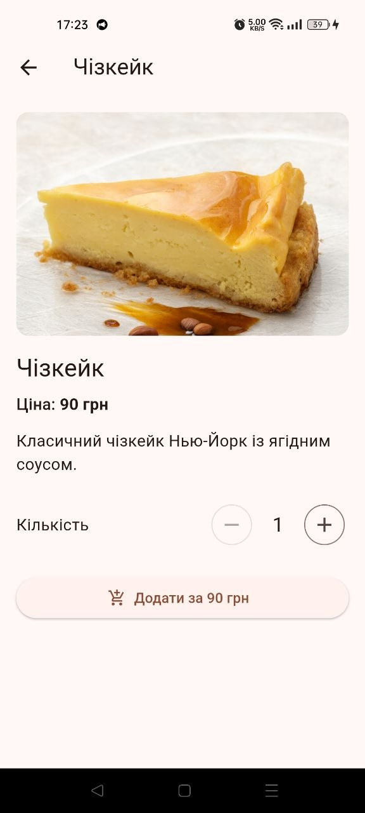

5. **Екран «Меню» після додавання товару** — видно сповіщення `SnackBar` та лічильник на іконці кошика (`Badge`).

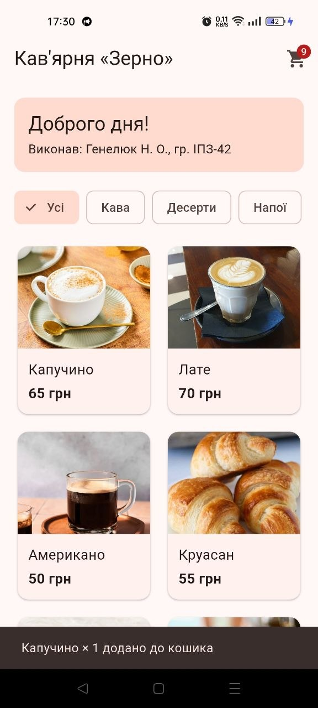

6. **Екран «Меню» з фільтром категорій** — вибрана категорія «Кава».

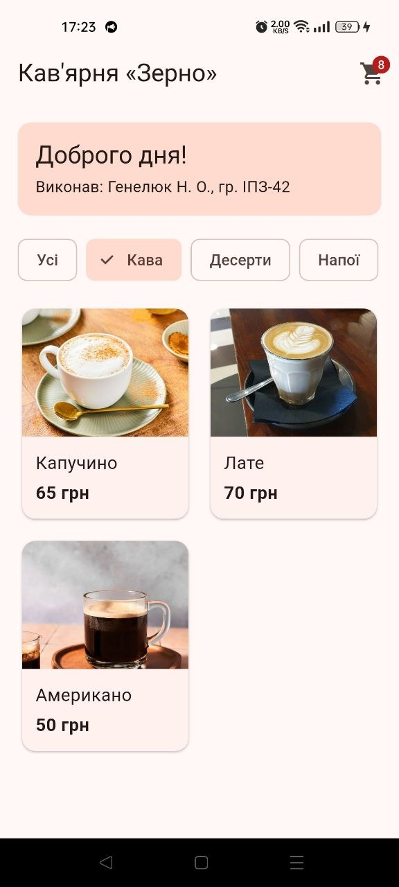

7. **Екран «Кошик»** — три різні товари з кількістю ≥ 2 та підсумковою сумою `715 грн`.

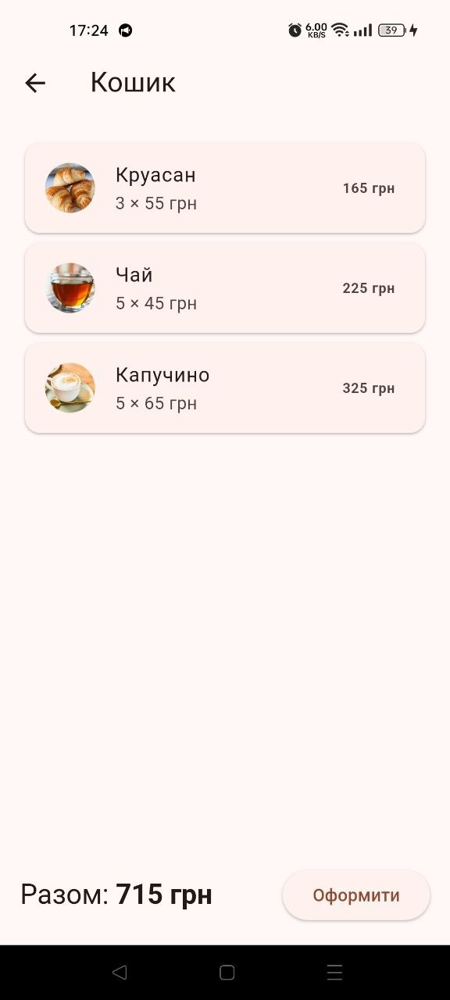

8. **Екран «Кошик» після видалення позиції свайпом** — позицію «Чай» видалено, суму перераховано (`490 грн`).

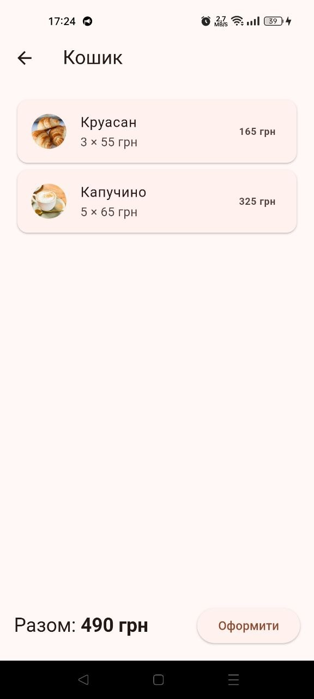

9. **Екран «Оформлення замовлення» (помилки валідації)** — перевірка порожнього імені та некоректного формату телефону.

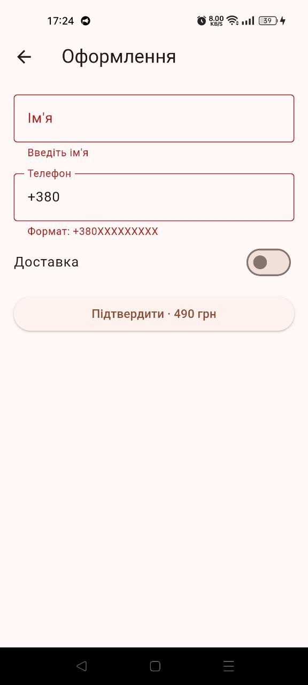

10. **Екран «Оформлення замовлення» (успішне оформлення)** — валідна форма та анімоване повідомлення «Замовлення прийнято!».

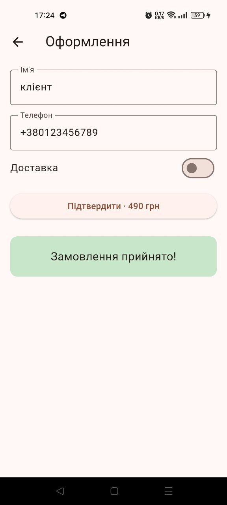

11. **Екран «Меню» в альбомній орієнтації** — адаптивна сітка у 3 стовпці з власними зображеннями товарів.

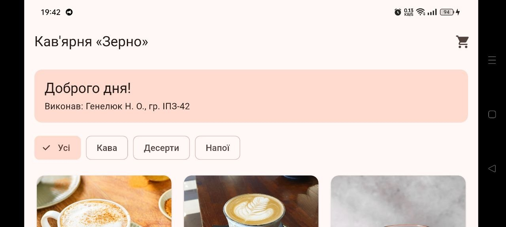

12. **Панель Flutter Inspector** — дерево віджетів екрана «Меню».

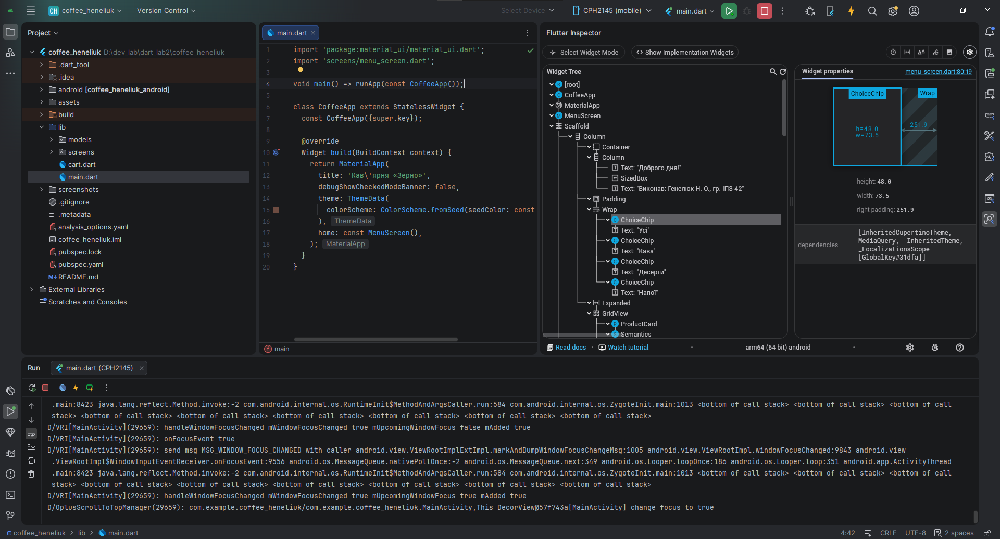
